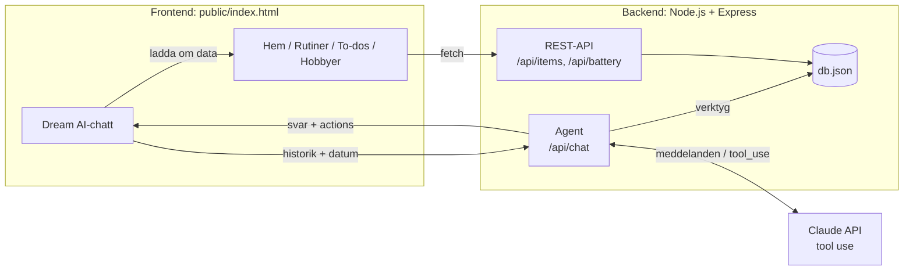
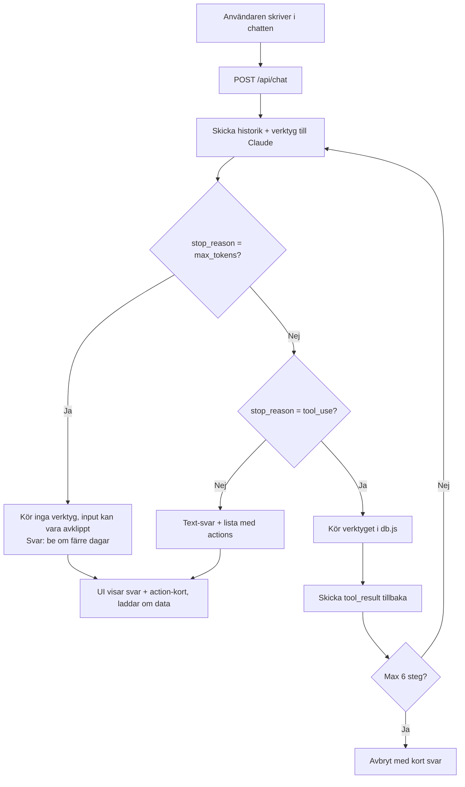

# Dream AI 2.0 – arkitektur

## Översikt



UI:t och agenten använder **samma funktioner i `db.js`**. Det AI:n gör syns direkt i batteriet, radarn och listorna.

## Agent-loopen



## Verktyg (tools)

| Verktyg | Gör | Exempel på fråga |
|---|---|---|
| `list_items` | Läser schema (datum eller intervall) | "Vad har jag imorgon?" |
| `add_items` | Lägger till 1–30 items | "Gör en gitarrplan för veckan" |
| `update_item` | Ändrar / bockar av | "Jag har tränat" |
| `delete_item` | Tar bort | "Ta bort tandläkaren" |
| `get_battery` | Batteri per kategori | "Hur ligger jag till?" |

## Pseudokod

```
funktion runAgent(historik, idag):
  meddelanden = historik
  actions = []
  upprepa max 6 gånger:
    svar = claude(systemprompt(idag), verktyg, meddelanden)
    om svar inte vill använda verktyg:
      returnera svar.text, actions
    för varje verktygsanrop i svar:
      försök:
        resultat = kör(verktyg, input)   // validerat i db.js
        actions += vad som ändrades
      vid fel:
        resultat = felmeddelande          // modellen får rätta sig själv
    meddelanden += svar, resultat
  returnera "hann inte bli klar", actions
```

## Säkerhet och robusthet

- API-nyckeln ligger bara i `.env` på servern, aldrig i frontend.
- All data valideras i `db.js` (datum, typ, prio, tider), både från UI och AI.
- Servern filtrerar chatthistoriken: bara text, max 20 meddelanden.
- AI-genererade namn escapas innan de visas (`esc()`), så ingen HTML-injektion.
- Max 6 steg i loopen skyddar mot oändliga loopar och höga kostnader.
