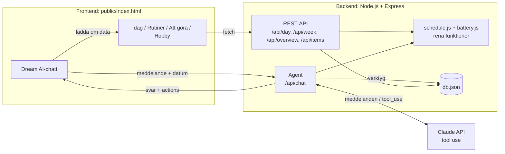
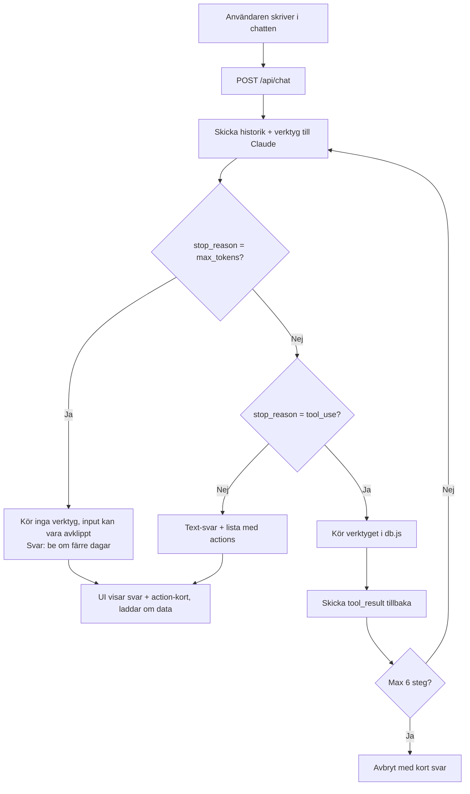

# Dream AI 2.0 – arkitektur

## Översikt



UI:t och agenten använder **samma funktioner i `db.js`**. Det AI:n gör syns direkt i batteriet och listorna. Frontend räknar aldrig ut batteriet själv, så det finns bara en formel.

## Datamodell

Ett item är en **regel**, inte en rad per dag. Det som visas i schemat räknas fram när det behövs.

```
{
  id, type, name, desc, prio,
  date,      // engångssak: dagen. att göra: deadline. regel: första dagen
  time,      // klockslag "18:00" eller null
  minutes,   // längd eller null
  repeat,    // { days: [1, 4], until: "2027-06-30" | null } eller null
  doneOn,    // { "2026-11-02": { at, gain, minutes, time } }, en bock per dag
  skip,      // dagar som tagits bort från en regel
  extra,     // dagar ett enskilt pass flyttats till
  notes,     // eget innehåll per dag, { "2026-11-03": "Skalor i C-dur" }
  archived   // borttaget men med historik, räknas kvar i batteriet
}
```

| Typ | Hur den beter sig |
|---|---|
| Rutin | Upprepas alltid: veckodagar, och ev. från/till. Bocka av dag för dag. |
| Att göra | En gång, med deadline. Öppen uppgift följer med till idag som försenad. Klar uppgift ligger på dagen den blev klar. Med klockslag är det en **tid att passa**: den ligger kvar på sin dag och kan inte bli försenad. |
| Hobby | En gång eller upprepad. "Gitarr: skalor" och "Gitarr: ackord" räknas som samma hobby i framstegen. |
| Bonus | Liten hälsoboost, en gång eller upprepad. |

En bock fryser vad passet var (laddning, minuter, klockslag). Ändras regeln efteråt är det gjorda ändå orört. Bockar man av en dag då inget var planerat räknas det som det senast missade passet de senaste 6 dagarna, så att sviten håller.

Filen är versionsmärkt. Gamla `db.json` (format 1) migreras när de läses: rutinrader med samma namn blir en regel, och `minTime`/`maxTime` blir `minutes`.

## Batteriet

Batteriet är **läget just nu**, inte en egenskap hos ett datum, och det visar **hur väl man håller sin egen plan**. Nivån lagras aldrig utan spelas upp ur `doneOn`:

```
nivå = 0
för varje avbockning i tidsordning:
  nivå -= 1 % per timme sedan förra händelsen (aldrig under 0)
  nivå += avbockningens frysta laddning (aldrig över 100)
nivå -= 1 % per timme fram till nu
räcker = nivå timmar
```

Laddningen sätts när man bockar av:

```
vikt(pass)   = 8 + min(minuter, 60) / 5
planens vikt = summan av alla pass den veckan (rutin och hobby)
veckoladdning = 7 * 24 * 1 % * 1,5 = 252 %
laddning     = vikt(pass) / planens vikt * veckoladdning
```

Att göra och bonus ligger utanför planen och ger 5 %.

Följer man hela planen laddas batteriet 1,5 gånger så mycket som det hinner tappa, **oavsett hur stor planen är**. Två tredjedelar av planen håller nivån, mindre sänker den. Simulering över tre veckor: en, tre och sex rutiner fylls alla till minst 85 % om planen hålls, och hälften av planen ger minst 40 enheter lägre nivå.

Eftersom nivån räknas fram blir ångra, efterregistrering av en glömd dag och nästa morgon rätt utan specialfall. Att planera in något ändrar inte nivån, bara vad nästa bock är värd. Kategorierna i stapeln följer samma uppspelning, så delarna alltid summerar till nivån.

## Agent-loopen



## Verktyg (tools)

| Verktyg | Gör | Exempel på fråga |
|---|---|---|
| `list_items` | Läser schema (datum, intervall) eller söker på namn (`query`) oavsett dag | "Vad har jag imorgon?" |
| `add_items` | Lägger till 1–30 items, allt eller inget. Återkommande = en post med `repeat` | "Gym måndag och torsdag fram till sommaren" |
| `update_item` | Ändrar en post | "Flytta tandläkaren till fredag" |
| `move_session` | Flyttar ett enda pass, regeln och sviten är kvar | "Flytta torsdagens gym till fredag" |
| `set_session_notes` | Ger enskilda dagar eget innehåll i ett återkommande pass | "Gör en gitarrplan för veckan" |
| `set_done` | Bockar av eller ångrar en dag | "Jag har tränat" |
| `delete_item` | Tar bort en post, eller med `date` bara en dag | "Ta bort tandläkaren" |
| `get_battery` | Batteriet just nu: nivå, timmar kvar, kategorier | "Hur ligger jag till?" |
| `get_progress` | Svit, pass denna vecka, minuter, senaste 30 dagarna | "Håller jag i gitarren?" |

## Pseudokod

```
funktion runAgent(historik, idag):
  meddelanden = historik                 // varje svar bär med sig [Utfört: ...]
  actions = []
  upprepa max 6 gånger:
    svar = claude(systemprompt(idag), verktyg, meddelanden)
    om svar inte vill använda verktyg:
      returnera svar.text, actions
    för varje verktygsanrop i svar:
      försök:
        resultat = kör(verktyg, input)   // validerat i db.js
        actions += vad som ändrades
      vid fel:
        resultat = felmeddelande          // modellen får rätta sig själv
    meddelanden += svar, resultat
  returnera "hann inte bli klar", actions
```

## Säkerhet och robusthet

- API-nyckeln ligger bara i `.env` på servern, aldrig i frontend.
- All data valideras i `db.js` (riktiga datum, typ, prio, klockslag, minuter, veckodagar), både från UI och AI.
- Samtalet sparas på servern, klienten skickar bara nya meddelandet. Modellen får de 20 senaste, med en loggrad om vad som faktiskt gjordes.
- Alla skrivningar går genom en kö och sparas via temporär fil + rename, så filen kan inte bli trasig av samtidiga anrop.
- Servern lyssnar bara på den egna datorn som standard (`HOST` i `.env` ändrar det), eftersom chatten kostar pengar och appen saknar inloggning.
- AI-genererade namn escapas innan de visas (`esc()`), så ingen HTML-injektion.
- Max 6 steg i loopen skyddar mot oändliga loopar och höga kostnader.
