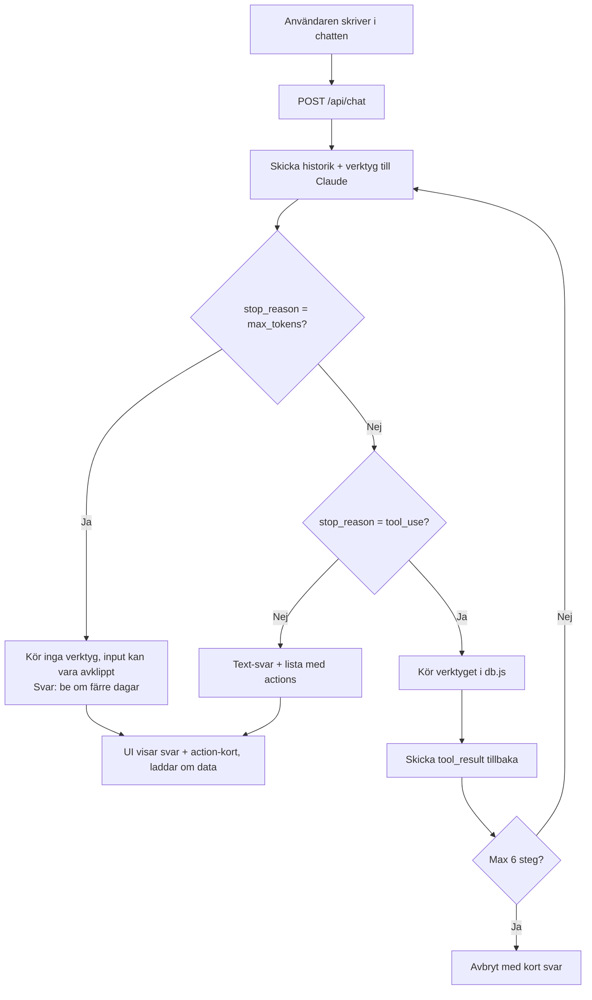

# Dream AI 2.0 – arkitektur

## Översikt


UI:t och agenten använder **samma funktioner i `db.js`**. Det AI:n gör syns direkt i energin och listorna. Frontend räknar aldrig ut energin själv, så det finns bara en formel.

## Datamodell

Ett item är en **regel**, inte en rad per dag. Det som visas i schemat räknas fram när det behövs.

```
{
  id, type, name, desc, prio,
  date,      // engångssak: dagen. att göra: deadline. regel: första dagen
  time,      // klockslag "18:00" eller null
  minutes,   // längd eller null
  repeat,    // { days: [1, 4], until: "2027-06-30" | null } eller null
  charge,    // bara laddare: hur många % den ger (1–30), annars null
  doneOn,    // { "2026-11-02": { at, minutes, time, charge? } }, en bock per dag
  skip,      // dagar som tagits bort från en regel
  extra,     // dagar ett enskilt pass flyttats till
  notes,     // eget innehåll per dag, { "2026-11-03": "Skalor i C-dur" }
  archived   // borttaget men med historik, dagens bock räknas kvar i energin
}
```

| Typ | Hur den beter sig |
|---|---|
| Rutin | Upprepas alltid: veckodagar, och ev. från/till. Bocka av dag för dag. |
| Att göra | En gång, med deadline. Öppen uppgift följer med till idag som försenad. Klar uppgift ligger på dagen den blev klar. Med klockslag är det en **tid att passa**: den ligger kvar på sin dag och kan inte bli försenad. |
| Hobby | En gång eller upprepad. "Gitarr: skalor" och "Gitarr: ackord" räknas som samma hobby i framstegen. |
| Laddare (`bonus`) | Något personligt som ger användaren energi, med egen laddning. En gång eller upprepad. |

En bock fryser vad passet var (minuter, klockslag, och laddning för en laddare). Ändras regeln efteråt är det gjorda ändå orört. Bockar man av en dag då inget var planerat räknas det som det senast missade passet de senaste 6 dagarna, så att sviten håller.

Filen är versionsmärkt. Gamla `db.json` (format 1) migreras när de läses: rutinrader med samma namn blir en regel, och `minTime`/`maxTime` blir `minutes`.

## Energin

Energin gäller **idag** och räknas fram varje gång, den lagras aldrig. Det enda som sparas är morgonens check-in, `checkins: { "2026-11-08": 40 }`. Reglerna finns i `energy.js`:

```
start    = check-in: 20 helt slut, 40 trött, 60 okej, 80 pigg, 100 full energi
kostnad  = minuter * 20 / 60, avrundat till hela 5 %, minst 5   (1 h fokus = 20 %)
laddning = laddarens egen siffra, annars 10
nu       = start - kostnad för det som är gjort idag + laddning för gjorda laddare   (0–100)
ikväll   = nu - kostnad för det som är kvar idag        (under 0 = överbokad dag)
räcker   = nu / 20 timmar fokus
```

Det gjorda räknas från bockarna med frysta minuter, även för sådant som tagits bort efteråt. Dagens plan räknas i minuter per typ (rutin, att göra, hobby). Laddare räknas inte in i planen, de är vila.

Utan check-in finns ingen energi, bara planen. Appen frågar då "Hur mår du idag?" i energikortet, och agenten kan spara check-in när användaren säger hur hen mår.

## Agent-loopen



## Verktyg (tools)

| Verktyg | Gör | Exempel på fråga |
|---|---|---|
| `list_items` | Läser schema (datum, intervall) eller söker på namn (`query`) oavsett dag | "Vad har jag imorgon?" |
| `add_items` | Lägger till 1–30 items, allt eller inget. Återkommande = en post med `repeat` | "Gym måndag och torsdag fram till sommaren" |
| `update_item` | Ändrar en post | "Flytta tandläkaren till fredag" |
| `move_session` | Flyttar ett enda pass, regeln och sviten är kvar | "Flytta torsdagens gym till fredag" |
| `set_session_notes` | Ger enskilda dagar eget innehåll i ett återkommande pass | "Gör en gitarrplan för veckan" |
| `set_done` | Bockar av eller ångrar en dag | "Jag har tränat" |
| `delete_item` | Tar bort en post, eller med `date` bara en dag | "Ta bort tandläkaren" |
| `get_energy` | Dagens energi: nu, ikväll, vad planen behöver, hur länge det räcker, plan per typ | "Hur ligger jag till?" |
| `set_checkin` | Sparar hur användaren mår som dagens start | "Jag är helt slut idag" |
| `get_progress` | Svit, pass denna vecka, minuter, senaste 30 dagarna | "Håller jag i gitarren?" |

## Pseudokod

```
funktion runAgent(historik, idag):
  meddelanden = historik                 // varje svar bär med sig [Utfört: ...]
  actions = []
  upprepa max 6 gånger:
    svar = claude(systemprompt(idag), verktyg, meddelanden)
    om svar inte vill använda verktyg:
      returnera svar.text, actions
    för varje verktygsanrop i svar:
      försök:
        resultat = kör(verktyg, input)   // validerat i db.js
        actions += vad som ändrades
      vid fel:
        resultat = felmeddelande          // modellen får rätta sig själv
    meddelanden += svar, resultat
  returnera "hann inte bli klar", actions
```

## Säkerhet och robusthet

- API-nyckeln ligger bara i `.env` på servern, aldrig i frontend.
- All data valideras i `db.js` (riktiga datum, typ, prio, klockslag, minuter, veckodagar), både från UI och AI.
- Samtalet sparas på servern, klienten skickar bara nya meddelandet. Modellen får de 20 senaste, med en loggrad om vad som faktiskt gjordes.
- Alla skrivningar går genom en kö och sparas via temporär fil + rename, så filen kan inte bli trasig av samtidiga anrop.
- Servern lyssnar bara på den egna datorn som standard (`HOST` i `.env` ändrar det), eftersom chatten kostar pengar och appen saknar inloggning.
- AI-genererade namn escapas innan de visas (`esc()`), så ingen HTML-injektion.
- Max 6 steg i loopen skyddar mot oändliga loopar och höga kostnader.
